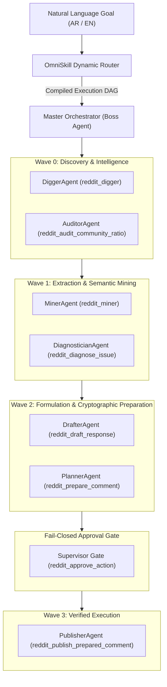

# Playbook: Autonomous Dynamic Routing & Multi-Agent Orchestration

> **Role:** Master Orchestration Control Plane & Dynamic Intent Router  
> **Primary Tools:** `reddit_agent_route`, `reddit_agent_orchestrate`  
> **Specification:** OmniSkill v6.2.0 & Poteto Mode  

---

## 1. Objective

Provide dynamic, zero-configuration intent execution for any Reddit automation request. Rather than requiring users to manually select and chain MCP tools, the Dynamic Router classifies natural language (Arabic or English) into an execution DAG, and the Master Orchestrator executes it wave-by-wave across specialized Tool-Agents.

---

## 2. Multi-Agent Ecosystem Architecture



---

## 3. Specialized Tool-Agent Personas

| Tool-Agent | Primary Tool | Core Invariant & Responsibility |
|---|---|---|
| **`DiggerAgent`** | `reddit_digger` | Maps target subreddits, executes keyless multi-tier search, collects candidate sources. |
| **`MinerAgent`** | `reddit_miner` | Extracts full submission text, sanitizes prompt injections, classifies buying signals. |
| **`DrafterAgent`** | `reddit_draft_response` | Strictly drafts 25–55 word Experience Grammar replies with mandatory disclosure. |
| **`PlannerAgent`** | `reddit_prepare_post`, `reddit_prepare_comment` | Generates dry-run ActionPlans with SHA-256 cryptographic signatures. |
| **`SupervisorGate`** | `reddit_approve_action` | Halts execution on mutating steps until affirmative human approval is received. |
| **`PublisherAgent`** | `reddit_publish_prepared_*` | Verifies hash integrity and publishes via authenticated OAuth driver. |
| **`AuditorAgent`** | `reddit_audit_community_ratio`, `reddit_whoami` | Audits 90/10 karma ratio and verifies account health. |
| **`DiagnosticianAgent`** | `reddit_diagnose_issue`, `reddit_plan_repair` | Isolates root cause on API errors and generates automated repair plans. |

---

## 4. Execution Workflow

### Step 1: Dynamic Routing (Compile DAG)
Call `reddit_agent_route`:
```json
{
  "prompt": "ابحث لي عن فرص لشركتي في r/SaaS"
}
```
The router outputs the classified intent, language, confidence score, and ordered waves.

### Step 2: Master Orchestration (Wave-by-Wave Dispatch)
Call `reddit_agent_orchestrate`:
```json
{
  "prompt": "Find SaaS opportunities and draft replies",
  "product": {
    "product_name": "MyProduct",
    "value_prop": "Fast database caching",
    "target_subreddits": ["SaaS", "webdev"]
  }
}
```
The Orchestrator:
1. Dispatches `DiggerAgent` to gather candidate threads.
2. Pipes sources into `MinerAgent` for intent signal scoring.
3. Pipes top survivors into `DrafterAgent` for Experience Grammar reply generation.
4. Pauses at human approval checkpoints if mutating operations are required.
5. Returns a structured `OrchestrationReport`.
