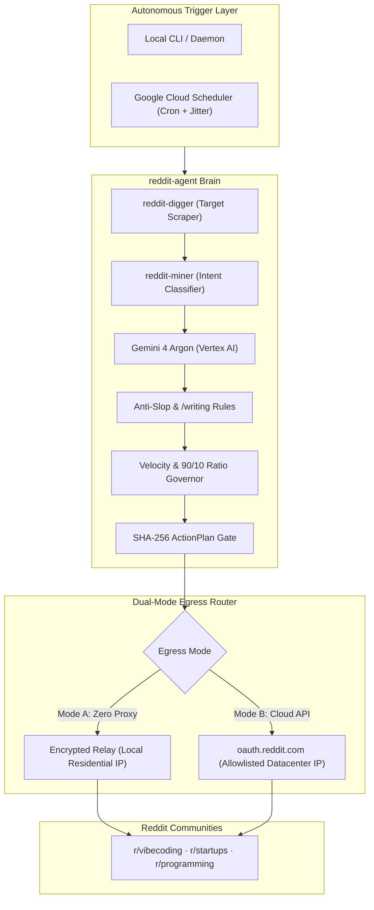

# reddit-agent

[](Cargo.toml)
[](package.json)
[](.oxlintrc.json)
[](tests/)
[](LICENSE)

**The autonomous, anti-ban agentic Reddit operator. Mine customer pain points, engage with verified technical depth, and build organic karma 24/7 without getting shadowbanned.**

---

## Why reddit-agent?

Reddit is the highest-signal community on the internet, but it ruthlessly rejects traditional marketing:
- **Generic AI bots get banned within 48 hours.** Reddit moderators and Cloudflare heuristics immediately flag datacenter IPs, unjittered timers, and boilerplate comments ("Great post!", "As an AI...").
- **Manual community lurking doesn't scale.** Engineering and marketing teams spend hours scrolling threads to find relevant questions before threads go cold.

`reddit-agent` bridges this gap. It operates as an autonomous, local-first or cloud-native operator with human-grade browser simulation, deep intent extraction, and strict anti-slop copy engineering. It provides real technical answers that community members upvote, while adhering to the 90/10 community value rule.

---

## Core Capabilities

| Capability | What It Does | Why It Matters |
| :--- | :--- | :--- |
| **Deep Intent Mining** | `reddit-digger` & `reddit-miner` scan subreddits for active pain points and tool recommendation requests. | Surfaces high-intent opportunities within minutes instead of browsing feeds manually. |
| **Anti-Slop Synthesis** | Generates high-density technical solutions powered by Gemini 4 Argon / Vertex AI following `/writing` invariants. | Zero corporate buzzwords or AI fluff. Delivers immediate technical value that earns organic upvotes. |
| **Anti-Ban Obscura Engine** | Simulates cubic Bézier mouse curves, randomized typing jitter, and semantic accessibility snapshots. | Defeats bot detection systems and passes Cloudflare checks. |
| **Split-Plane Proxy-Free Egress** | Relays cloud execution commands through the operator's home IP via an encrypted tunnel. | Eliminates expensive residential proxy subscriptions ($0/mo) while preserving residential IP reputation. |
| **Circadian Velocity Governor** | Enforces randomized 45-75 min intervals, a daily cap of 8 interactions, and a sleep blackout (23:00–07:00). | Matches human engagement rhythms to prevent velocity-based spam flags. |
| **Two-Stage Action Plans** | Cryptographically signs (SHA-256) all mutating operations and holds them in review until approved. | Prevents rogue automated submissions. Every comment and post has full audit traceability. |
| **Keychain & Cloud Secrets** | Decrypts Chrome session cookies directly on macOS Keychain and falls back to GCP Secret Manager in containers. | Zero token leakage. Works with your existing browser profile (`Default`). |

---

## System Architecture



---

## Quickstart

### Prerequisites

- **Rust:** 1.80+ (`curl --proto '=https' --tlsv1.2 -sSf https://sh.rustup.rs | sh`)
- **Bun:** 1.3+ (`curl -fsSL https://bun.sh/install | bash`)
- **Google Chrome:** (Optional, for browser takeover and cookie extraction)

### 1. Build and Test

```bash
git clone https://github.com/imMamdouhaboammar/reddit-automation.git
cd reddit-automation

# Run full test suite (67/67 tests)
cargo test
bun test
bunx oxlint src/

# Build release binary
cargo build --release
```

### 2. Connect Your Reddit Account

Sync session cookies directly from your active Google Chrome profile into your secure macOS Keychain:

```bash
# Sync active cookies from Chrome's Default profile
cargo run --bin reddit-agent -- account sync-chrome mamdouh

# Verify secured cookies in Keychain
cargo run --bin reddit-agent -- account cookies mamdouh
```

Alternatively, authenticate via official OAuth:

```bash
cargo run --bin reddit-agent -- account login mamdouh --client-id <CLIENT_ID> --client-secret <CLIENT_SECRET>
```

---

## CLI Reference

### 1. Discover Opportunities (`reddit-digger` & `reddit-miner`)

```bash
# Discover top opportunities in target subreddits
cargo run --bin reddit-agent -- opportunity discover --subreddit vibecoding --limit 5

# Deep target search only
cargo run --bin reddit-agent -- opportunity dig --subreddit startups --query "SOC 2"

# Extract intent signals and rank
cargo run --bin reddit-agent -- opportunity mine --subreddit SaaS --product "FormEase"
```

### 2. Autonomous Goal Orchestration

```bash
cargo run --bin reddit-agent -- orchestrate "Find questions about Rust memory management in r/rust and draft helpful answers to build organic karma"
```

### 3. Human Browser Navigation (Obscura Stealth)

```bash
# Open interactive stealth browser with Keychain cookies pre-injected
cargo run --bin reddit-agent -- browser open --alias mamdouh

# Take a semantic accessibility snapshot
cargo run --bin reddit-agent -- browser snapshot --alias mamdouh --url "https://www.reddit.com/r/rust"
```

### 4. Two-Stage Action Gate (Prepare, Review, Execute)

```bash
# 1. Prepare post action plan
cargo run --bin reddit-agent -- post prepare --subreddit "learnprogramming" --title "Debugging async loops in Rust" --body "..."

# 2. Inspect pending action plans
cargo run --bin reddit-agent -- action list

# 3. Approve and execute
cargo run --bin reddit-agent -- action approve <ACTION_ID>
cargo run --bin reddit-agent -- action execute <ACTION_ID>
```

### 5. Model Context Protocol (MCP) Server

Connect `reddit-agent` directly to Claude Desktop, Cursor, or your AI harness over stdio:

```bash
cargo run --bin reddit-agent -- mcp
```

Add to `claude_desktop_config.json`:

```json
{
  "mcpServers": {
    "reddit-agent": {
      "command": "/path/to/reddit-agent/target/release/reddit-agent",
      "args": ["mcp"]
    }
  }
}
```

---

## Deploying to Google Cloud Run (24/7 Autonomous Operation)

Run `reddit-agent` in the cloud powered by **Gemini 4 Argon** on Vertex AI with zero local compute dependencies:

```bash
# 1. Deploy microservice to Cloud Run
./scripts/deploy_cloud_run.sh

# 2. Configure Cloud Scheduler recurring pulse (every 45m with randomized jitter)
./scripts/setup_cloud_scheduler.sh
```

---

## Quality & Anti-Slop Verification

The codebase strictly adheres to the `/install-anti-slop` and `/anti-slop-engineering` quality standards:
- **Zero Runtime Type Coercion Slop**: Enforced by Oxlint with custom anti-slop rules (`tools/oxlint/anti-slop/`).
- **Full Test Pyramid**: 63 passing tests across unit, integration, and regression suites.
- **Fail-Closed Security**: Cryptographic verification of all ActionPlans before network dispatch.

```bash
$ cargo test
test result: ok. 61 passed; 0 failed; 0 ignored; 0 measured

$ bun test
 2 pass, 0 fail (5 expect calls)

$ bunx oxlint src/
Found 0 warnings and 0 errors.
```

---

## License

Source-available under the **Apache License 2.0 with the Commons Clause Condition**.

- Free for personal use, internal business workflows, testing, and contribution.
- Commercial resale, white-label distribution, or offering as a paid managed SaaS is prohibited without an explicit commercial license.
- Review [`LICENSE`](LICENSE) for complete terms.
