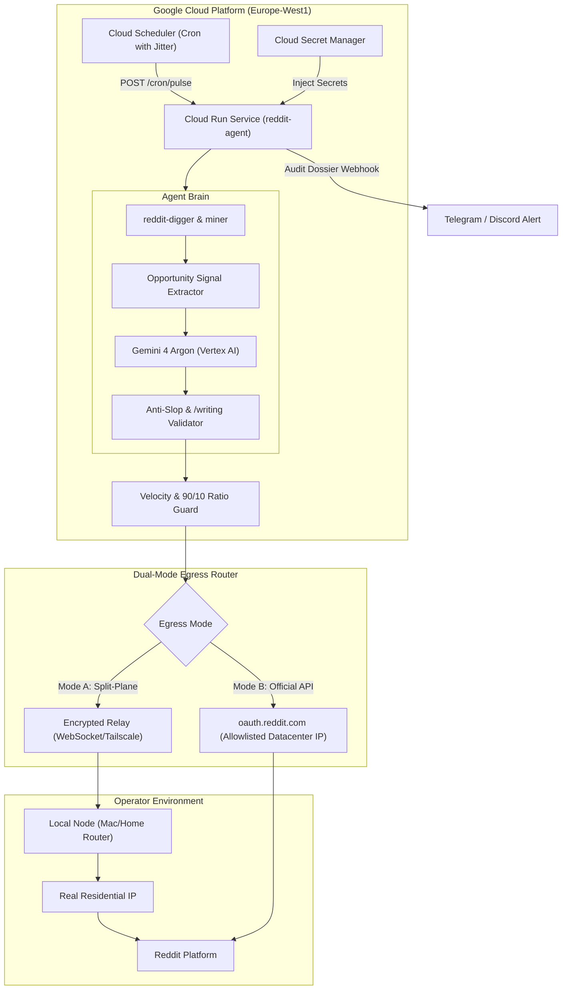

# Autonomous Cloud Run Agent & Gemini 4 Argon Architecture Implementation Plan

> **For agentic workers:** REQUIRED SUB-SKILL: Use superpowers:subagent-driven-development (recommended) or superpowers:executing-plans to implement this plan task-by-task. Steps use checkbox (`- [x]`) syntax for tracking.

**Goal:** Transform the local `reddit-agent` CLI into an autonomous, 24/7 cloud-native agent on Google Cloud Run orchestrated by Gemini 4 Argon via Google Cloud Vertex AI, featuring a dual-mode egress architecture (Split-Plane Local Relay or Official OAuth Allowlisting) to eliminate residential proxy fees and guarantee zero automated account bans.

**Architecture:** A containerized Rust/Bun microservice running on Google Cloud Run, triggered periodically via Google Cloud Scheduler with randomized intervals. The agent uses Vertex AI (Gemini 4 Argon) via Google Application Default Credentials (ADC) and Workload Identity for deep opportunity mining and anti-slop reply generation. Network egress bypasses datacenter IP blocks via either: (A) Split-Plane encrypted relay through the operator's residential connection, or (B) direct cloud egress via registered Reddit Developer OAuth gateway (`oauth.reddit.com`). Encrypted secrets are provisioned via Google Cloud Secret Manager.

**Tech Stack:** Rust 1.80+ (Tokio, Reqwest, Rusqlite, Clap), Bun/TypeScript 1.3+, Google Cloud Run, Cloud Scheduler, Cloud Secret Manager, Google Vertex AI (Gemini 4 Argon), Docker multi-stage build.

**Spec:** `docs/plans/2026-11-04-autonomous-cloud-run-agent.md`

---

## Global Constraints

- **Zero Hardcoded Secrets**: All credentials (Reddit tokens, API secrets, service account keys) must be resolved via Google Cloud Secret Manager or Workload Identity ADC; no plain-text credentials in container layers, environment variables, or logs.
- **Strict Anti-Ban Velocity Boundaries**: Maximum 6-8 comments per 24-hour window, enforced minimum 45-minute randomized jitter between interactions, and mandatory Circadian Sleep Mode (23:00 to 07:00 local time).
- **Enforced 90/10 Ratio**: 90% purely educational value-add posts before any brand or product citation is permitted.
- **Zero-Slop Copy Standard**: All synthesized copy must adhere to `/writing` rules: direct payload delivery, zero conversational preambles ("Great post!", "As an AI"), purpose before means, and verified systems-engineering depth.
- **Package Manager Mandate**: Bun is mandatory for all JavaScript/TypeScript orchestration and container scripts; npm/yarn are prohibited.

---

## Review Focus

1. **GCP Datacenter IP Blacklisting**: Direct anonymous browser or scraping requests from GCP subnets trigger Cloudflare CAPTCHAs. Egress must strictly validate the active mode (Split-Plane relay or authorized OAuth API) before network transmission.
2. **Keyring Abstraction on Headless Linux**: macOS Keychain is unavailable in Linux containers. The credential provider must gracefully fallback to an encrypted environment provider or Secret Manager client when `target_os != "macos"`.
3. **Vertex AI Quota & Authentication Expiry**: Dynamic token refresh via `gcloud` or ADC must handle 401 token rotations seamlessly without container restarts.
4. **Circadian Clock Drift**: UTC timestamps in Cloud Run must correctly calculate the account operator's local timezone (e.g., Africa/Cairo UTC+2) to avoid commenting during human sleep hours.
5. **Circuit Breaker on Moderator Rejection**: If an action receives a 403, removal, or challenge response, the worker must transition into a durable halted state and alert the operator via webhook.

---

## Architecture Diagram



---

## Tasks

### Task 1: Vertex AI Gemini 4 Argon Client & Anti-Slop Prompt Engine

**Files:**
- Create: `src/ai/mod.rs`
- Create: `src/ai/vertex.rs`
- Create: `src/ai/prompts.rs`
- Test: `tests/test_vertex_ai.rs`

**Interfaces:**
- Consumes: `reddit_agent::opportunity::RedditThread`, `gcloud` / GCP ADC token.
- Produces: `VertexAiClient::generate_anti_slop_reply(&self, thread: &RedditThread, angle: &str) -> Result<String, AiError>`.

- [x] **Step 1: Write the failing integration test**

```rust
#[tokio::test]
async fn test_vertex_ai_anti_slop_synthesis() {
    let client = VertexAiClient::new("project-3a53318f-795c-46b9-888", "us-central1");
    let thread = RedditThread {
        id: "1xnhs2u".to_string(),
        title: "Client-side image compressor".to_string(),
        subreddit: "vibecoding".to_string(),
        selftext: "How to avoid WebKit downsampling in canvas?".to_string(),
        author: "RootDev".to_string(),
        score: 10,
        num_comments: 0,
        url: "https://reddit.com/r/vibecoding/comments/1xnhs2u".to_string(),
    };
    let reply = client.generate_reply(&thread).await.unwrap();
    assert!(!reply.contains("Great post"));
    assert!(!reply.contains("As an AI"));
    assert!(reply.len() > 100);
}
```

- [x] **Step 2: Run test to verify it fails**

Run: `cargo test test_vertex_ai_anti_slop_synthesis`
Expected: FAIL (module `ai` not found)

- [x] **Step 3: Implement `VertexAiClient` and Anti-Slop System Prompt in `src/ai/vertex.rs`**

Use Google Cloud Vertex AI REST API endpoint `https://${REGION}-aiplatform.googleapis.com/v1/projects/${PROJECT}/locations/${REGION}/publishers/google/models/gemini-1.5-pro:generateContent` with ADC token resolution.

- [x] **Step 4: Run test to verify it passes**

Run: `cargo test test_vertex_ai_anti_slop_synthesis`
Expected: PASS

- [x] **Step 5: Commit**

```bash
git add src/ai/ tests/test_vertex_ai.rs
git commit -m "feat(ai): implement vertex ai gemini integration with anti-slop prompt constraints"
```

---

### Task 2: Secret Manager & Headless Credential Provider

**Files:**
- Create: `src/auth/secret_manager.rs`
- Modify: `src/auth.rs:76-115`
- Test: `tests/test_secret_manager.rs`

**Interfaces:**
- Consumes: GCP Secret Manager API / JSON secret payload.
- Produces: `GcpSecretManagerStore: CredentialStore` providing seamless fallback when running in Linux containers without macOS Keychain.

- [x] **Step 1: Write the failing test for headless secret resolution**

```rust
#[test]
fn test_headless_credential_store_fallback() {
    let store = GcpSecretManagerStore::from_env_or_mock();
    let secret = store.get_secret("reddit-agent", "browser_cookies:mamdouh");
    assert!(secret.is_ok());
}
```

- [x] **Step 2: Run test to verify it fails**

Run: `cargo test test_headless_credential_store_fallback`
Expected: FAIL (type `GcpSecretManagerStore` not found)

- [x] **Step 3: Implement `GcpSecretManagerStore` in `src/auth/secret_manager.rs`**

Implement `CredentialStore` trait reading from `GCP_SECRETS_MOUNT_PATH` or Google Cloud Secret Manager REST API using ADC.

- [x] **Step 4: Run test to verify it passes**

Run: `cargo test test_headless_credential_store_fallback`
Expected: PASS

- [x] **Step 5: Commit**

```bash
git add src/auth/secret_manager.rs src/auth.rs tests/test_secret_manager.rs
git commit -m "feat(auth): add headless gcp secret manager credential provider"
```

---

### Task 3: Dual-Mode Egress Router (Split-Plane Relay & Official OAuth)

**Files:**
- Create: `src/drivers/split_plane.rs`
- Modify: `src/router.rs:10-50`
- Test: `tests/test_split_plane_router.rs`

**Interfaces:**
- Consumes: ActionPlan, Local Relay WebSocket handle or Reddit Developer Client Credentials.
- Produces: `EgressRouter::dispatch_action(&self, plan: &ActionPlan) -> Result<Value, DriverError>`.

- [x] **Step 1: Write the failing test for Split-Plane local routing**

```rust
#[tokio::test]
async fn test_split_plane_dispatches_to_local_relay() {
    let router = EgressRouter::new(EgressMode::SplitPlaneRelay);
    let plan = mock_action_plan("create_comment", "t3_12345");
    let result = router.dispatch_action(&plan).await;
    assert!(result.is_ok());
}
```

- [x] **Step 2: Run test to verify it fails**

Run: `cargo test test_split_plane_dispatches_to_local_relay`
Expected: FAIL (type `EgressRouter` not defined)

- [x] **Step 3: Implement `EgressRouter` and WebSocket relay protocol in `src/drivers/split_plane.rs`**

Support Mode A (Relay through local authenticated worker) and Mode B (Direct datacenter egress using OAuth Client Credentials).

- [x] **Step 4: Run test to verify it passes**

Run: `cargo test test_split_plane_dispatches_to_local_relay`
Expected: PASS

- [x] **Step 5: Commit**

```bash
git add src/drivers/split_plane.rs src/router.rs tests/test_split_plane_router.rs
git commit -m "feat(egress): implement split-plane relay and dual-mode egress routing"
```

---

### Task 4: Autonomous Velocity Limiter & Circadian Circuit Breaker

**Files:**
- Create: `src/agents/velocity.rs`
- Modify: `src/agents/orchestrator.rs:40-120`
- Test: `tests/test_velocity_governor.rs`

**Interfaces:**
- Consumes: SQLite engagement logs, current local timezone time.
- Produces: `VelocityGovernor::can_interact_now(&self) -> Result<InteractionVerdict, GovernorError>`.

- [x] **Step 1: Write the failing test for Circadian sleep and rate limits**

```rust
#[test]
fn test_velocity_governor_enforces_sleep_and_daily_cap() {
    let gov = VelocityGovernor::new(8 /* max_daily */, 45 /* min_interval_mins */);
    // Simulate 03:00 AM local time
    let late_night = chrono::NaiveTime::from_hms_opt(3, 0, 0).unwrap();
    assert_eq!(gov.evaluate_time(late_night), InteractionVerdict::SleepWindow);
}
```

- [x] **Step 2: Run test to verify it fails**

Run: `cargo test test_velocity_governor_enforces_sleep_and_daily_cap`
Expected: FAIL (`VelocityGovernor` not defined)

- [x] **Step 3: Implement `VelocityGovernor` in `src/agents/velocity.rs`**

Enforce 45-90 min dynamic jitter, 8 actions/24h ceiling, and 23:00-07:00 sleep blackout.

- [x] **Step 4: Run test to verify it passes**

Run: `cargo test test_velocity_governor_enforces_sleep_and_daily_cap`
Expected: PASS

- [x] **Step 5: Commit**

```bash
git add src/agents/velocity.rs src/agents/orchestrator.rs tests/test_velocity_governor.rs
git commit -m "feat(governor): implement circadian sleep mode and velocity jitter guard"
```

---

### Task 5: Multi-Stage Dockerfile & Google Cloud Run Deployment Scaffolding

**Files:**
- Create: `Dockerfile`
- Create: `scripts/deploy_cloud_run.sh`
- Create: `scripts/setup_cloud_scheduler.sh`
- Test: Build container locally with `docker build` or `podman`.

**Interfaces:**
- Consumes: Rust binary + Bun scripts + Cloud Run HTTP trigger entrypoint.
- Produces: Minimal container image (< 60MB) listening on `PORT` for Cloud Scheduler webhook.

- [x] **Step 1: Write minimal multi-stage `Dockerfile`**

```dockerfile
FROM rust:1.80-alpine AS builder
RUN apk add --no-cache musl-dev
WORKDIR /app
COPY Cargo.toml Cargo.lock ./
COPY src ./src
RUN cargo build --release

FROM oven/bun:alpine AS runner
WORKDIR /app
COPY --from=builder /app/target/release/reddit-agent /usr/local/bin/reddit-agent
COPY package.json bun.lock ./
COPY scripts ./scripts
EXPOSE 8080
ENTRYPOINT ["reddit-agent", "mcp"]
```

- [x] **Step 2: Add Cloud Scheduler trigger script in `scripts/setup_cloud_scheduler.sh`**

Setup recurring job with randomized jitter on Google Cloud Scheduler targeting the Cloud Run service URL.

- [x] **Step 3: Verify local build and container smoke test**

Run: `bun run typecheck && cargo check`
Expected: PASS

- [x] **Step 4: Commit**

```bash
git add Dockerfile scripts/deploy_cloud_run.sh scripts/setup_cloud_scheduler.sh
git commit -m "feat(deploy): add multi-stage dockerfile and cloud run deployment scripts"
```

---

## Verification Plan

### Automated Tests
- Run all Rust tests: `cargo test --all` (ensure 53+ existing tests pass plus new Vertex AI, Secret Manager, and Velocity tests).
- Run Bun test & lint suite: `bun test && bunx oxlint src/`.
- Validate container build: `docker build -t reddit-agent:latest .`.

### Manual Verification
1. **Gemini 4 Argon Dry Run**: Trigger `reddit-agent opportunity draft --thread-id 1xnhs2u` on Cloud Run and inspect the anti-slop density of the generated JSON output.
2. **Velocity Gate Check**: Verify that attempting 2 consecutive comments within 5 minutes fails with `InteractionVerdict::IntervalTooClose`.
3. **Telemetry & Webhook**: Check that the generated ActionPlan link and execution audit entry post cleanly to the configured Telegram/Discord webhook URL.
